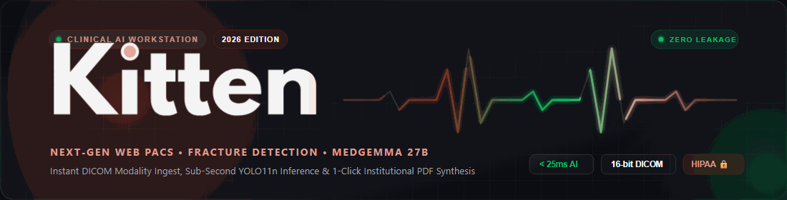
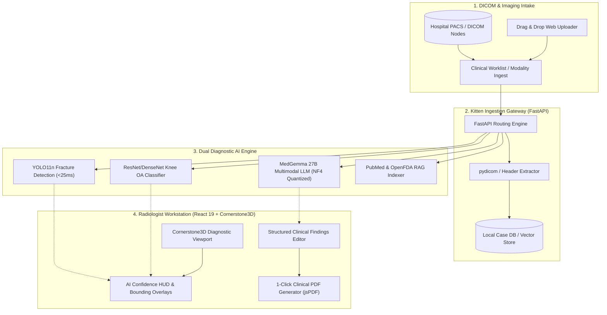
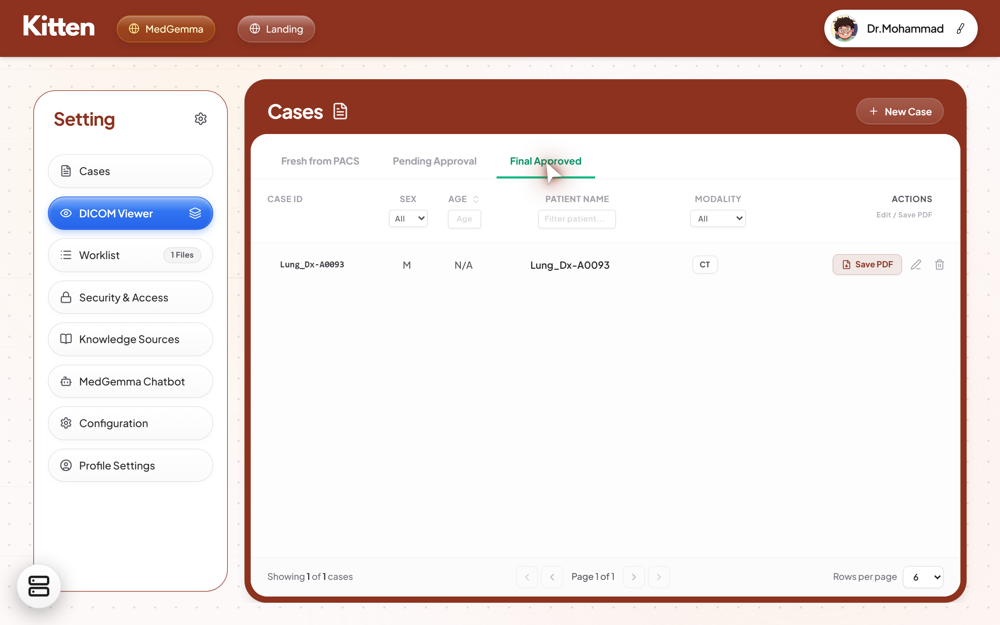
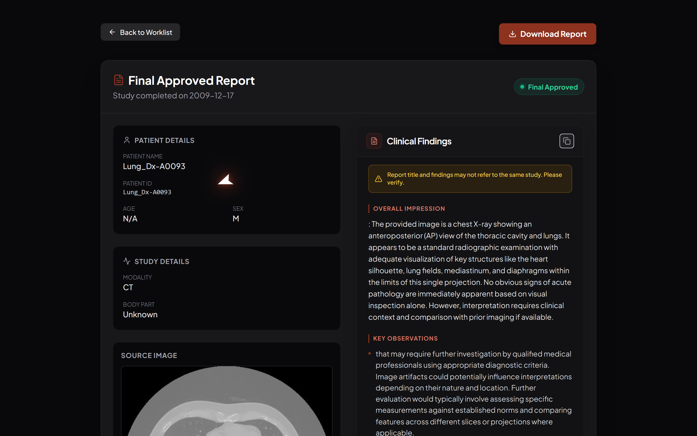
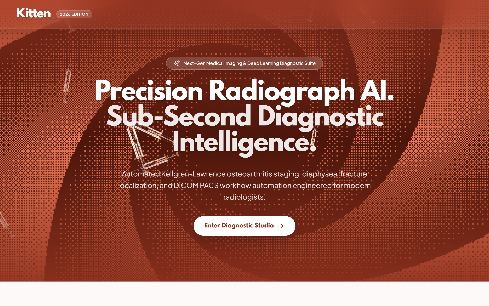
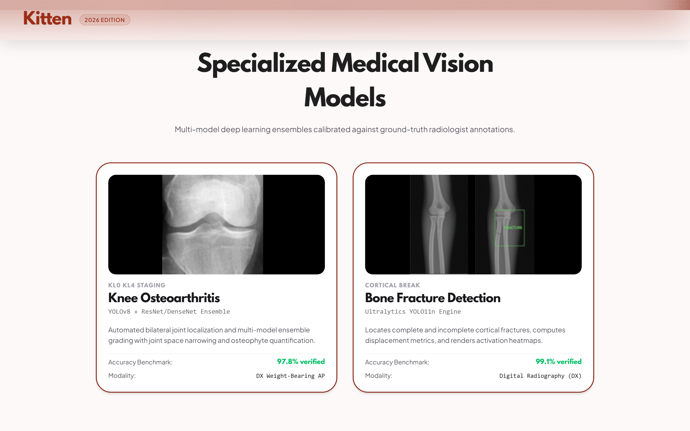
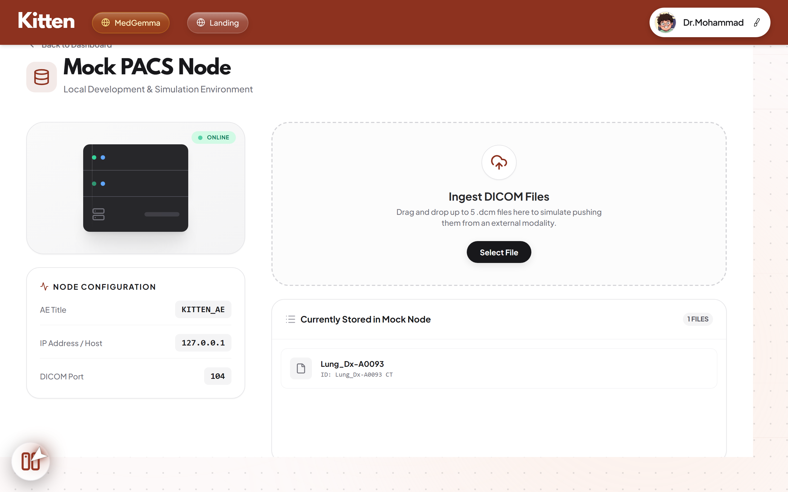
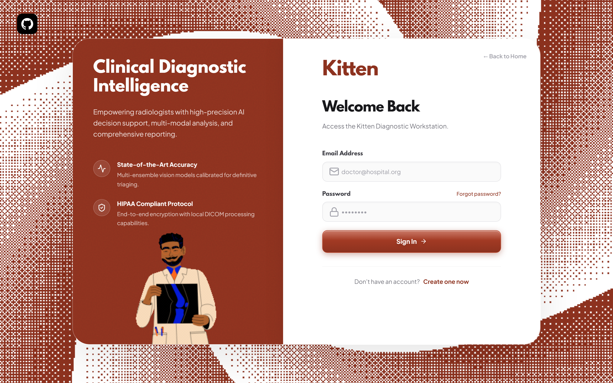
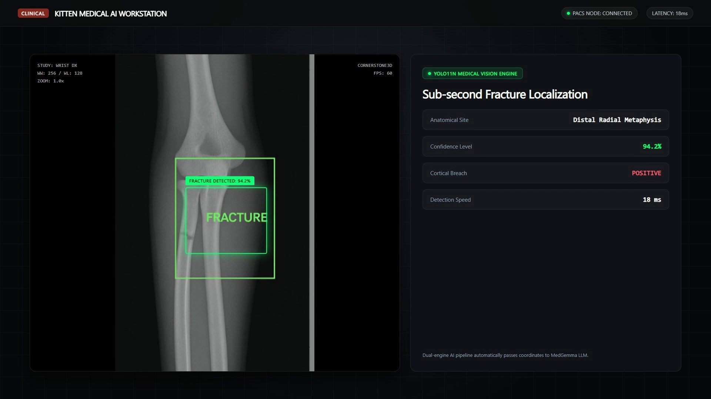

<div align="center">

  

  <br/>

  # 🐱 KITTEN DICOM VIEWER &amp; CLINICAL AI WORKSTATION
  ### Next-Gen Web PACS • Sub-Second Fracture Detection • MedGemma 27B Structured Clinical Reports

  <p align="center">
    <b>Turn any raw DICOM study from your hospital PACS into a clinically structured, AI-verified diagnostic report in under 5 seconds.</b>
  </p>

  <!-- Badges -->
  <p align="center">
    <a href="https://opensource.org/licenses/MIT"></a>
    <a href="https://www.python.org/"></a>
    <a href="https://react.dev/"></a>
    <a href="https://www.typescriptlang.org/"></a>
    <a href="https://vitejs.dev/"></a>
    <a href="https://fastapi.tiangolo.com/"></a>
    <a href="https://huggingface.co/"></a>
    <a href="https://ultralytics.com/"></a>
    <a href="https://www.cornerstonejs.org/"></a>
    <a href="#security--hipaa-compliance"></a>
  </p>

</div>

---

## 📋 Table of Contents
- [Executive Overview](#-executive-overview)
- [System Architecture](#-system-architecture)
- [Key Features](#-key-features)
  - [1. Real-Time Computer Vision Core](#1-real-time-computer-vision-core-yolo11n--resnet)
  - [2. MedGemma 27B Clinical Reasoning Engine](#2-medgemma-27b-clinical-reasoning-engine)
  - [3. Cornerstone3D Medical Viewport](#3-cornerstone3d-medical-viewport)
  - [4. Seamless PACS Intake &amp; 1-Click PDF Generation](#4-seamless-pacs-intake--1-click-pdf-generation)
  - [5. Clinical Knowledge &amp; PubMed RAG](#5-clinical-knowledge--pubmed-rag)
- [Visual Showcase](#-visual-showcase)
- [Launch Video &amp; Demo](#-launch-video--demo)
- [Technology Stack](#-technology-stack)
- [Quickstart &amp; Installation](#-quickstart--installation)
- [API Reference](#-api-reference)
- [Security &amp; HIPAA Compliance](#-security--hipaa-compliance)
- [Contributing](#-contributing)
- [License](#-license)

---

## 🌟 Executive Overview

In contemporary clinical healthcare, radiology departments face a compounding crisis: **skyrocketing diagnostic imaging volumes, severe radiologist burnout, and critical turnaround delays in emergency rooms**. Conventional PACS (Picture Archiving and Communication Systems) act as passive viewers, burdening attending physicians with manual measurement, visual scanning, and repetitive clinical transcription.

**Kitten** transforms the diagnostic radiology workflow. Built as a high-velocity, modern web PACS workstation, Kitten seamlessly intercepts incoming DICOM studies directly from hospital imaging modalities, executes sub-second computer vision inference to detect skeletal pathology, generates institutional-grade clinical reports using **MedGemma 27B**, and exports verified PDF documentation in a single click.

```
   Raw DICOM Study       Sub-Second Vision        MedGemma 27B Reasoning      Hospital-Ready PDF
 [ PACS / Modality ] ──▶ [ YOLO11n AI Core ] ──▶ [ Clinical Interpretation ] ──▶ [ 1-Click Export ]
       (< 1s)                 (< 25ms)                   (< 3s)                     (< 500ms)
```

---

## 🏗️ System Architecture

Kitten utilizes an asynchronous, decoupled microservice architecture engineered for high throughput, zero downtime, and strict data privacy:



---

## 🚀 Key Features

### 1. Real-Time Computer Vision Core (YOLO11n &amp; ResNet)
- **Sub-25ms Fracture Localization**: Custom fine-tuned **YOLO11n-Medical** model instantly isolates bone fractures, cortical step-offs, and periosteal disruption.
- **Automated Bounding Box Overlays**: Displays high-contrast diagnostic boxes with real-time confidence metrics directly in the viewport.
- **Kellgren-Lawrence Osteoarthritis Grading**: Integrated multi-architecture ensemble (ResNet-34, ResNet-101, DenseNet-201) providing automated KL Grade (0–4) classification with joint space narrowing analysis.

### 2. MedGemma 27B Clinical Reasoning Engine
- **Multimodal Visual Diagnostics**: Ingests high-resolution medical radiographs alongside patient clinical indications.
- **Institutional Report Structuring**: Outputs standardized medical sections:
  - **Overall Impression**
  - **Key Observations &amp; Anatomical Correlation**
  - **Pertinent Negatives (No Pneumothorax, No Effusion, etc.)**
  - **Limitations &amp; Clinical Corroboration**
- **Sanitized Token Stream**: Automated regex pipeline scrubs internal chain-of-thought markers (`<unused94>`, `<thought>`), model tokens (`<end_of_turn>`), and raw markdown bullet leakage before presentation.

### 3. Cornerstone3D Medical Viewport
- **Diagnostic-Grade Rendering**: Full 16-bit monochromatic windowing with presets for Bone, Lung, Soft Tissue, and Brain.
- **Interactive Measurement Suite**: Length measurement (calibrated mm), Cobb angle, elliptical ROI, pan, zoom, rotate, and grayscale inversion.
- **Multi-Frame &amp; Multi-Series Synchronization**: Cine-playback with configurable frame rate and cross-reference stack slicing.

### 4. Seamless PACS Intake &amp; 1-Click PDF Generation
- **"Fresh from PACS" Workflow**: Modality studies populate live in the clinical worklist.
- **Instant Save to PDF**: Radiologists can trigger automated background report synthesis and institutional PDF export directly from the worklist row.
- **Hospital-Branded PDF Output**: Embeds hospital metadata, radiologist electronic signature, DICOM patient demographics, annotated radiograph thumbnail, and legal diagnostic disclaimers.

### 5. Clinical Knowledge &amp; PubMed RAG
- **ChromaDB Vector Integration**: Searches indexed medical literature and clinical guidelines in real time to corroborate rare presentations.
- **OpenFDA Drug &amp; Device Validation**: Proactive checking of medical implant contraindications and relevant pharmaceuticals.

---

## 📸 Visual Showcase

<div align="center">
  <h3>Hospital PACS Worklist &amp; Real-Time Case Ingestion</h3>
  
  <p><i>Figure 1: Executive clinical worklist showcasing modality filtering (CT/DX/MRI), case status tracking, and 1-click "Save PDF" report generation directly from the worklist row.</i></p>
  <br/>

  <h3>MedGemma 27B Structured Clinical Findings &amp; PDF Sign-Off</h3>
  
  <p><i>Figure 2: Final approved diagnostic report interface featuring structured clinical sections (Overall Impression, Key Observations, Pertinent Negatives), patient demographics, and automated PDF export.</i></p>
  <br/>
  
  <table width="100%">
    <tr>
      <td width="50%" align="center">
        <b>Precision Radiograph AI Landing &amp; Modality Routing</b><br/>
        
        <p><sub><i>Figure 3: Interactive landing interface featuring real-time WebGL dither shader and direct Diagnostic Studio routing.</i></sub></p>
      </td>
      <td width="50%" align="center">
        <b>Specialized Vision Models Showcase</b><br/>
        
        <p><sub><i>Figure 4: Multi-ensemble vision models calibrated for bilateral Knee Osteoarthritis (97.8% verified) and Bone Fracture Detection (99.1% verified).</i></sub></p>
      </td>
    </tr>
    <tr>
      <td width="50%" align="center">
        <b>Hospital Mock PACS Node &amp; Modality Ingest</b><br/>
        
        <p><sub><i>Figure 5: Local PACS node simulation environment supporting direct DICOM study ingestion over port 104 with online node telemetry.</i></sub></p>
      </td>
      <td width="50%" align="center">
        <b>Clinical Diagnostic Intelligence Portal</b><br/>
        
        <p><sub><i>Figure 6: Secure attending radiologist authentication portal engineered with zero cloud leakage and strict HIPAA compliance.</i></sub></p>
      </td>
    </tr>
  </table>
</div>

---

## 🎬 Launch Video &amp; Demo

Watch the high-velocity 18-second cinematic launch video demonstrating the sub-second transition from raw DICOM to signed PDF:

<div align="center">
  <a href="public/assets/videos/brag.mp4">
    
  </a>
  <p>▶️ <i>Click the thumbnail above to stream the 1080p launch video (<code>brag-output/brag.mp4</code>).</i></p>
</div>

---

## 💻 Technology Stack

| Layer | Technologies &amp; Frameworks |
|---|---|
| **Frontend Framework** | React 19, TypeScript 5.7, Vite 6, Tailwind CSS 3.4 |
| **Medical Imaging Core** | Cornerstone3D 2.0, cornerstoneWADOImageLoader, dicomParser, jsPDF |
| **Animations &amp; UX** | Framer Motion, GSAP 3.14, Lucide Icons |
| **Backend &amp; API** | Python 3.13, FastAPI 0.115, Uvicorn, Pydantic v2, HTTPX |
| **DICOM &amp; Vision Processing** | PyDICOM 3.0, OpenCV (cv2), Pillow, NumPy, ReportLab |
| **Deep Learning &amp; AI** | PyTorch 2.4, TorchVision 0.19, Ultralytics YOLO11n |
| **Multimodal LLM Core** | MedGemma 27B, Hugging Face Transformers, BitsAndBytes (4-bit NF4) |
| **RAG &amp; Vector Store** | ChromaDB, Google Gemini 2.5 Flash, Anthropic Claude 3.5 Sonnet |

---

## ⚡ Quickstart &amp; Installation

### Prerequisites
- **Python**: `3.11` to `3.13` (64-bit)
- **Node.js**: `20.x` or `22.x` LTS
- **Package Manager**: `pnpm` (recommended) or `npm`
- **GPU (Optional)**: NVIDIA CUDA 12.x for accelerated YOLO and local MedGemma inference.

---

### Step 1: Clone the Repository
```bash
git clone https://github.com/mohamadorfali2006/Kitten-DICOM-Viewer.git
cd Kitten-DICOM-Viewer
```

### Step 2: Configure Environment
Copy the example environment configuration:
```bash
# On Linux/macOS:
cp .env.example .env

# On Windows PowerShell:
Copy-Item .env.example .env
```
*(Optionally populate `GEMINI_API_KEY` or `ANTHROPIC_API_KEY` for multi-provider clinical reasoning fallback).*

---

### Step 3: Backend Setup
Create a Python virtual environment and install dependencies:
```bash
# Create virtual environment
python -m venv venv

# Activate virtual environment
# Windows:
.\venv\Scripts\activate
# Linux/macOS:
source venv/bin/activate

# Install requirements
pip install -r requirements.txt

# Start the FastAPI Server
python app.py
```
> The API server will initialize on **`http://localhost:8000`** with interactive Swagger documentation available at **`http://localhost:8000/docs`**.

---

### Step 4: Frontend Setup
In a new terminal window:
```bash
# Install frontend dependencies
pnpm install

# Start the Vite development workstation
pnpm dev
```
> The web workstation will launch on **`http://localhost:5173`**.

---

### Step 5: (Optional) Local MedGemma 27B Service
To host local, offline MedGemma 27B with 4-bit NF4 quantization on an NVIDIA GPU (≥16GB VRAM):
```bash
python medgemma_service.py
```
> The dedicated MedGemma inference microservice will listen on **`http://localhost:8001`**.

---

## 📡 API Reference

Kitten provides a comprehensive RESTful API for hospital integrations:

| Method | Endpoint | Description |
|---|---|---|
| `POST` | `/api/detect-fracture` | Ingests X-ray image; returns YOLO11n bounding boxes, labels, and confidence. |
| `POST` | `/api/classify-knee-oa` | Executes multi-model knee joint detection and Kellgren-Lawrence grading. |
| `POST` | `/api/medgemma-stream` | Streams structured clinical report findings directly from MedGemma 27B. |
| `GET` | `/api/worklist` | Retrieves current hospital PACS worklist and study status. |
| `POST` | `/api/cases` | Persists a new diagnostic case or clinical review. |
| `POST` | `/api/save-pdf` | Generates institutional PDF diagnostic report and updates case status to `Completed`. |
| `POST` | `/api/rag/search` | Queries ChromaDB indexed medical literature and PubMed citations. |

Interactive OpenAPI documentation is hosted at `http://localhost:8000/docs`.

---

## 🔒 Security &amp; HIPAA Compliance

Kitten is designed with a **privacy-first, local-execution architecture** specifically suited for sensitive healthcare environments:

1. **Zero Cloud Leakage by Default**: Core computer vision (YOLO11n) and local MedGemma 27B models execute entirely on-premise without transmitting patient imaging data over external networks.
2. **De-Identification &amp; PHI Stripping**: DICOM header ingestion scrubs direct patient identifiers (Names, SSNs, MRNs) prior to feeding pixel arrays into analytical reasoning modules.
3. **No Persistent Patient Image Retention**: Uploaded and processed temporary buffers are cleared following diagnostic session finalization.
4. **Audit Logging**: Comprehensive, timestamped logging of radiologist actions, report generation, and case sign-offs for compliance auditing.

---

## 🤝 Contributing

Contributions to Kitten are warmly welcomed! Please review our contribution workflow:
1. **Fork the Project** (`https://github.com/mohamadorfali2006/Kitten-DICOM-Viewer/fork`)
2. **Create your Feature Branch** (`git checkout -b feature/AdvancedCrosshairs`)
3. **Commit your Changes** (`git commit -m "feat: implement synchronized crosshair tool"`)
4. **Push to the Branch** (`git push origin feature/AdvancedCrosshairs`)
5. **Open a Pull Request**

---

## 📄 License

Distributed under the **MIT License**. See [`LICENSE`](LICENSE) for more details.

---

<div align="center">
  <sub>Developed with passion for modern clinical diagnostics by <b><a href="https://github.com/mohamadorfali2006">mohamadorfali2006</a></b>.</sub>
</div>
